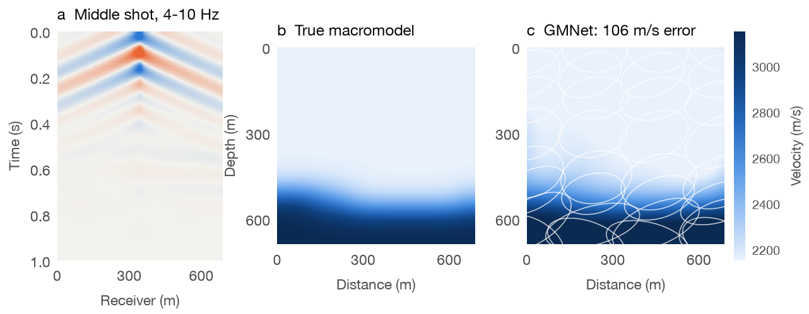
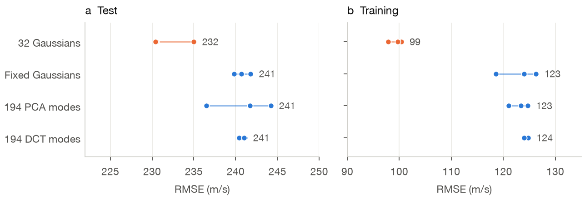
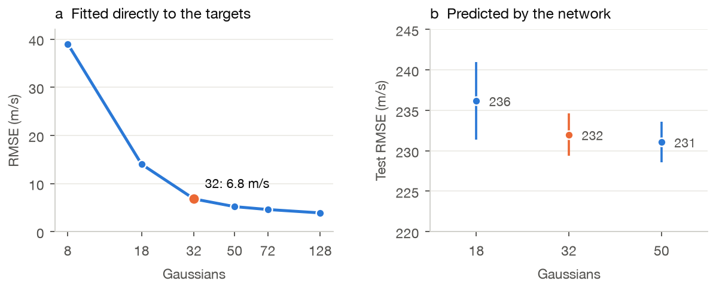
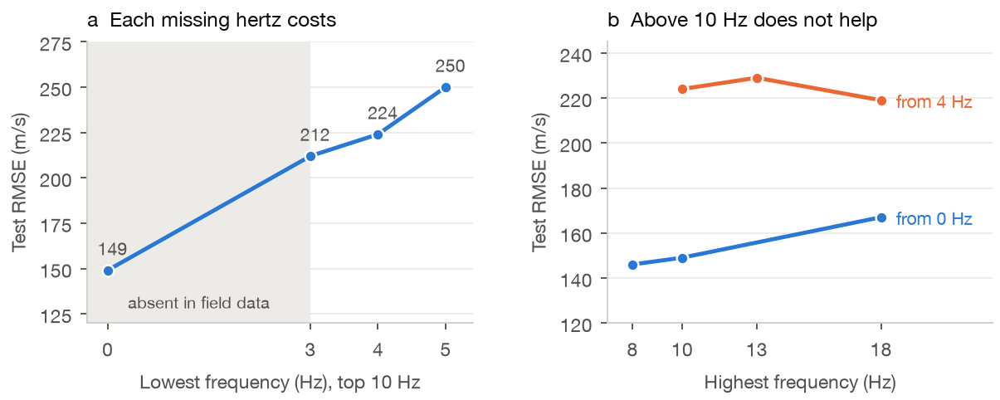
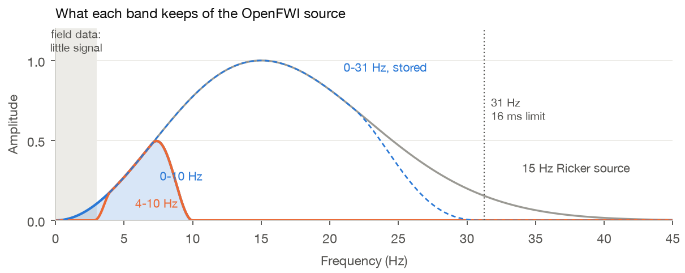
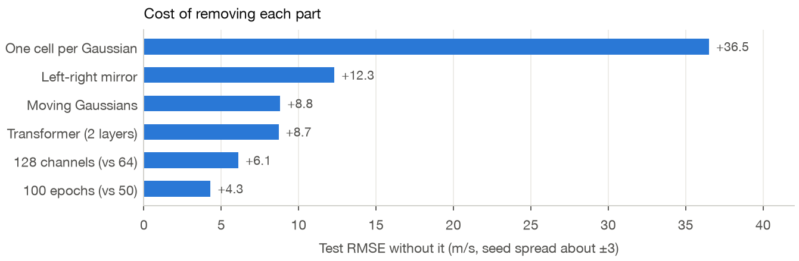
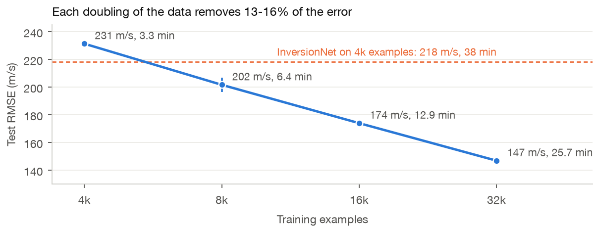

# How GMNet was designed

Every choice in GMNet was settled by a measurement. This page goes through them in the order we
made them: the representation first, then the data, the network, the training and the test.

All numbers are test errors (RMSE, m/s) on 480 held-out models from the ten OpenFWI Vel, Fault and
Style families, after training on 4,000 examples at 4-10 Hz, unless a section says otherwise.
Seeds are given where they matter. The spread between seeds is about ±3 m/s.



*A test case of median error for its family: (a) the data GMNet reads, (b) the target, (c) the
prediction of a network trained on 4,000 examples, each Gaussian drawn as a one-sigma ellipse.*

---

## 1. Why Gaussians

Full-waveform inversion needs a starting model that is right at large scales: a **macromodel**.
Most networks predict it pixel by pixel, 4,900 numbers for a 70 × 70 model, most of them spent on
detail that low-frequency data cannot resolve.

GMNet writes the macromodel as a few smooth blobs on a depth-linear background:

v(x, z) = 3000 + background(z) + Σ<sub>k</sub> a<sub>k</sub> · exp(−½ (r − μ<sub>k</sub>)ᵀ Σ<sub>k</sub>⁻¹ (r − μ<sub>k</sub>))

Each Gaussian has a velocity a, a centre μ, two widths and an angle. This buys four things:

- **Always smooth and valid.** Widths stay between 50 and 300 m, so no prediction is noisy.
- **Continuous.** The model can be drawn on any grid.
- **Linear in velocity.** For any set of shapes, the best velocities are one least-squares solve.
  That separates *where* the network places Gaussians from *how fast* it makes them.
- **Few numbers.** 32 Gaussians are 194 numbers in all.

Gaussians are not just a closer fit. We gave the same network 194 other outputs of the same
size: PCA modes, DCT modes, or Gaussians frozen in place. PCA and DCT fit the targets almost
perfectly (0.08 and 0.09 m/s), yet the network learned them worse, on new models *and* on its own
training data:



*Three seeds each. Moving Gaussians are easier to predict, not merely easier to fit.*

## 2. How many Gaussians

We first fitted K Gaussians directly to the targets, with no network. The error falls steeply up to
32 and barely after. Then we trained the network with 18, 32 and 50:



*(a) Direct fits. (b) Network, three seeds each.*

**32 is the fewest within noise of the best**, so 32 it is, arranged as 4 columns by 8 depth rows.
At 4-18 Hz, 72 Gaussians gave 218.0 against 219.4 for 32: more Gaussians do not help even with
more frequencies.

## 3. Which frequencies

Field surveys record little usable signal below about 3 Hz [1, 2]. OpenFWI keeps every frequency [8].
A network trained on it learns from data no real survey has, so we measured what each band
is worth:



*One seed per point.*

- **The low end decides.** Losing 0-3 Hz adds 63 m/s, and each further hertz adds 12-26 more.
- **Above 10 Hz does not help.** From 4 Hz, a top of 10, 13 or 18 Hz is within noise. From 0 Hz,
  18 Hz is *worse* than 10 Hz (167 vs 149). A macromodel lives in the low frequencies.

The data are processed once, keeping 0-31 Hz, and the band is chosen when training. GMNet
suggests two:

| Band | Use |
|---|---|
| **0-10 Hz** (default) | Compare with other OpenFWI networks: the best band we measured |
| **4-10 Hz** | The realism check: the band field data have [1] |

Any other band inside 0-31 Hz can be tried by setting `band` in `config.toml`.



*The 15 Hz Ricker source of OpenFWI and what each band keeps. The stored data end at 31 Hz, the
most 16 ms samples hold. Other papers feed the full band, up to about 40 Hz; 0-31 Hz is the
closest GMNet gets.*

## 4. Sampling: 16 ms and 20 m

A macromodel needs 10 Hz at most, far less than OpenFWI's 1 ms samples and 10 m receivers:

- **16 ms in time.** Samples every 16 ms hold up to 31 Hz, three times the 10 Hz edge, so the
  stored data keep 0-31 Hz. Finer samples would add only frequencies that did not help, and
  quadruple the input. At 32 ms even 10 Hz would sit near the 15.6 Hz limit.
- **20 m in space.** Pairs of receivers are averaged. The shortest wavelength at 31 Hz in the
  slowest rock (1500 m/s) is 48 m; 20 m keeps more than the two samples per wavelength needed.

Each shot goes from 1000 × 70 to 63 × 35 numbers: 32 times smaller. Since the stored data hold
nothing above 31 Hz, filtering them to a band later gives the same result as filtering the raw
recording, to within 1%. This is also why the whole of OpenFWI fits in about 10 GB.

## 5. The target

The target is the true model smoothed with a 50 m Gaussian. It removes only detail far below what
10 Hz resolves (half the shortest wavelength is 75 m). The Gaussians' bounds follow the same scale:

- **50 m narrowest**, the target's own smoothing.
- **300 m widest**, about 700 m across, one wavelength at 4 Hz in 3000 m/s rock.

The trained network chooses widths of 62-160 m for 90% of its Gaussians, so neither bound is
binding.

## 6. The network

One pass and no decoder:

```
shots [5,63,35] ─CNN─> 8×5 map ─resize─> 4×8 cells ─transformer─> 32 Gaussians + background ─render─> 70×70 model
```

- **Input.** Each example is divided by its own RMS and passed through `asinh`, so the absolute
  amplitude of the survey does not matter.
- **CNN.** Eight 3 × 3 convolution blocks (GroupNorm, LeakyReLU), three with stride 2, 32 to 128
  channels.
- **One cell per Gaussian.** The last map is resized to the 4 × 8 lattice. Cell k sits over where
  Gaussian k starts: later times over deeper Gaussians, receiver columns over x.
- **Mixing.** The 32 cells and one background token (their mean) pass two transformer layers, so
  every Gaussian sees the others.
- **Heads.** Two MLPs shared by all cells give each Gaussian its shape, as an offset from the
  lattice, and its velocity; a third gives the background. All start at zero, so training starts
  from the lattice at 3000 m/s.

In total 0.9M weights and 0.22 GFLOPs per model, 15 times less than InversionNet [3].

Each part was removed in turn, three seeds each:



*Measured against the version before the last simplification (232.0 ± 2.6).*

- **One cell per Gaussian** is the single biggest choice. One shared feature for all Gaussians
  costs 36.5 m/s. This mirrors feed-forward Gaussian splatting in vision [4].
- **Two transformer layers.** None costs 8.7, one costs 3.0, four gain 0.2 at 1.7 times the time.
- **No training statistics.** Slot embeddings, dropout, a start fitted to the mean model and a
  fixed amplitude scale each cost nothing, so all four were removed. The network starts at
  3000 m/s everywhere. It divides each example by its own amplitude, because the strength of a real
  source is unknown. Together the removals cost 3.9 m/s, the price of a network that assumes
  nothing about its training set.

## 7. Training

- **The loss is the drawn model alone.** Nothing about the Gaussians is supervised. The model is
  drawn on a 35 × 35 grid for the loss, which gives the same error as 70 × 70 (168.1 vs 167.8) at a
  quarter of the cost.
- **Mirror left-right**, half of each batch. This is exact for four of the five sources; the middle
  one lands 10 m off. It is worth 12.3 m/s at 4,000 examples.
- AdamW at 10⁻³, 100 epochs, batch 64. The whole training set sits in memory.

## 8. The test

- **RMSE** against the 50 m-smoothed target, on the full 70 × 70 grid.
- **FWI-ready**, the field criterion for a starting model. First-arrival times through the
  prediction must stay within half a period of those through the true model at 4 Hz, 125 ms, or
  waveform inversion cycle-skips [5]. Times are computed by shortest paths [6]. With 690 m offsets,
  this tests only the shallow part, so it is necessary, not sufficient.
- **Geometry bound.** The predicted shapes with exactly solved velocities: how good the placement
  alone is.

## 9. The limit is data, not the network

Trained on more OpenFWI with nothing else changed, the error keeps falling:



*Three seeds up to 16,000 examples, two at 32,000. All 100% FWI-ready.*

At 32,000 examples, the network is still far from what 32 Gaussians can express: 6.8 m/s fitted
directly, and about 50 m/s for the shapes predicted at 4,000 examples. The representation is not
the bottleneck, so GMNet's speed is best spent on more data [7].

## 10. What did not make it

- **Iterative refinement**, three attention passes over a model-space map: slower and less accurate
  than one pass.
- **A pyramid of sizes**: 8 large, 18 medium and 32 small Gaussians for three sub-bands. It tied
  with 32 plain Gaussians and was 30% slower; the Gaussians already choose their own size.
- **Velocity-scale training**, showing each model also as s · v. It gained about 10 m/s at 4,000
  examples but doubles every step. New data is the better use of that compute.

## References

1. Sun, Sun, Nammour, Rivera, Williamson & Demanet. Learning with real data without real labels: a strategy for extrapolated full-waveform inversion with field data. *GJI*, 2023. [doi:10.1093/gji/ggad330](https://doi.org/10.1093/gji/ggad330)
2. Li & Demanet. Full-waveform inversion with extrapolated low-frequency data. *Geophysics* 81(6), 2016.
3. Wu & Lin. InversionNet: an efficient and accurate data-driven full waveform inversion. 2018. [arXiv:1811.07875](https://arxiv.org/abs/1811.07875)
4. Charatan et al. pixelSplat. *CVPR*, 2024. [arXiv:2312.12337](https://arxiv.org/abs/2312.12337)
5. Virieux & Operto. An overview of full-waveform inversion in exploration geophysics. *Geophysics* 74(6), 2009. [doi:10.1190/1.3238367](https://doi.org/10.1190/1.3238367)
6. Moser. Shortest path calculation of seismic rays. *Geophysics* 56(1), 1991. [doi:10.1190/1.1442958](https://doi.org/10.1190/1.1442958)
7. Jin et al. An empirical study of large-scale data-driven full waveform inversion. 2023. [arXiv:2307.15388](https://arxiv.org/abs/2307.15388)
8. Deng et al. OpenFWI: large-scale multi-structural benchmark datasets for full waveform inversion. *NeurIPS Datasets and Benchmarks*, 2022. [arXiv:2111.02926](https://arxiv.org/abs/2111.02926)
